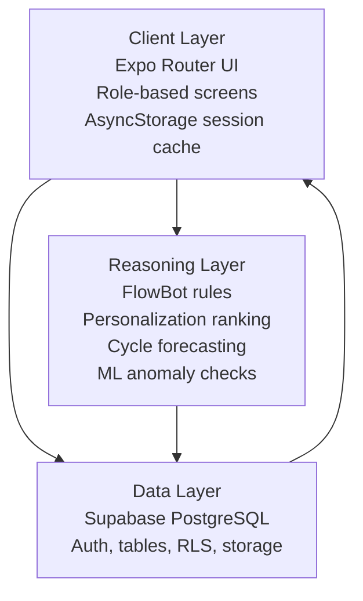
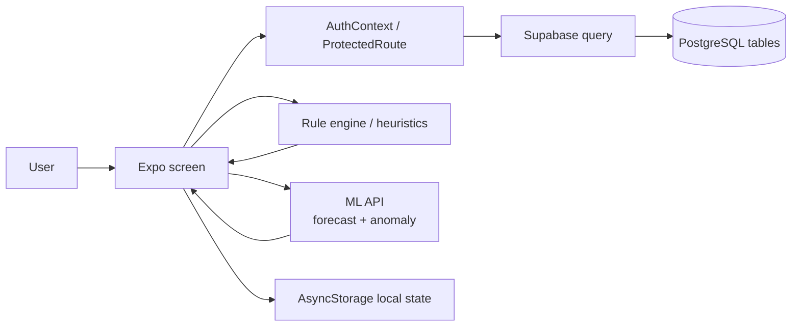
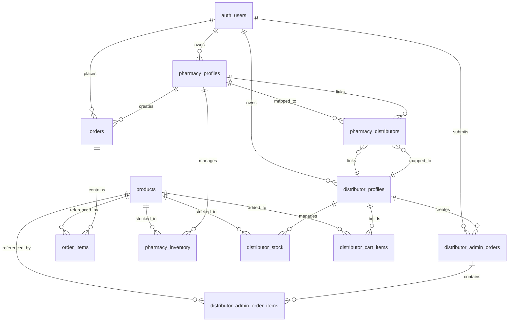

# Swasthya

Swasthya is a multi-role healthcare and pharmaceutical operations app built with Expo Router, Supabase, and TypeScript. It combines menstrual-health education, symptom tracking, AI-assisted product recommendations, pharmacy inventory management, distributor ordering, and admin oversight in one mobile-first codebase.

The project is organized around a deterministic health assistant and a direct Supabase data model rather than a separate custom backend. That keeps the system auditable, fast to iterate on, and easier to reason about in a regulated domain.

## What’s In The App

The codebase currently supports these roles and flows:

- Customer onboarding, login, and health quiz flow.
- Consumer dashboards for learning content, period tracking, FlowBot Q&A, and profile management.
- Pharmacy workflows for catalog browsing, carting, order placement, inventory management, and dashboard insights.
- Distributor workflows for stock management, pharmacy relationships, carting, and distributor-to-admin orders.
- Admin workflows for user oversight, product management, order review, distributor/pharmacy management, and ML-backed anomaly checking.

## Architecture

### Three-Layer Architecture



The app keeps presentation, persistence, and decision logic separated:

- Client Layer: everything under `app/`, plus shared components and auth context.
- Data Layer: Supabase tables, auth, and file storage.
- Reasoning Layer: heuristics and ML integration in `services/swasthyaML.ts`.

### Data Flow Architecture



Typical request flow:

1. The user opens a role-specific screen under `app/`.
2. `AuthContext` restores or clears the local session state.
3. Screens query Supabase directly for the needed tables.
4. Business logic runs locally for recommendations, FlowBot responses, MOQ checks, and cycle estimation.
5. Pharmacy/admin screens call the external ML API through `services/swasthyaML.ts` for reorder forecasting and anomaly detection.
6. Results are rendered immediately and some session data is cached in AsyncStorage for a smoother reload experience.

### Entity-Relationship Diagram



Compact table view of the main entities:

| Entity                          | Purpose                                                                  |
| ------------------------------- | ------------------------------------------------------------------------ |
| `products`                      | Master catalog with name, SKU, image, distributor price, price, and MOQ. |
| `orders`                        | Pharmacy-to-admin order header.                                          |
| `order_items`                   | Line items for pharmacy orders.                                          |
| `distributor_admin_orders`      | Distributor-to-admin order header.                                       |
| `distributor_admin_order_items` | Line items for distributor-admin orders.                                 |
| `pharmacy_profiles`             | Pharmacy identity, status, and contact data.                             |
| `distributor_profiles`          | Distributor identity, status, and contact data.                          |
| `pharmacy_inventory`            | Pharmacy inventory, reorder level, and stock quantity.                   |
| `distributor_stock`             | Distributor stock and local warehouse inventory.                         |
| `pharmacy_distributors`         | Many-to-many mapping between pharmacies and distributors.                |
| `distributor_cart_items`        | Saved distributor cart state.                                            |
| `hercircle_assets`              | Uploaded assets used by product management.                              |

## Key Modules

### Client Shell

- `app/_layout.tsx` mounts `AuthProvider`, a loading gate, a root error boundary, and the Expo Router stack.
- `context/AuthContext.tsx` stores the current user payload in AsyncStorage.
- `context/ProtectedRoute.tsx` keeps role access aligned with the current session.

### Role Areas

- `app/(tabs)/` contains the consumer-facing home, tracker, FlowBot, learn, and profile screens.
- `app/pharmacy/` contains inventory, cart, catalog, dashboard, order history, and settings.
- `app/distributor/` contains catalog, cart, stock, orders, pharmacy mapping, and settings.
- `app/admin/` contains overview, user management, product management, order review, and support pages.

### Reasoning And ML

- `services/swasthyaML.ts` maps local UUIDs into the ML system’s expected IDs and calls the forecast and anomaly endpoints.
- The app uses deterministic heuristics for health content, cycle prediction, and urgency handling rather than an LLM.

## Tech Stack

| Layer                 | Stack                                                 |
| --------------------- | ----------------------------------------------------- |
| Client                | Expo, Expo Router, React Native, React 19             |
| Language              | TypeScript                                            |
| State                 | React hooks, AsyncStorage                             |
| Data                  | Supabase, PostgreSQL                                  |
| Integrations          | Supabase Auth, Expo file/image tools, external ML API |
| Charts / UI utilities | React Native Calendars, Expo icons, Lucide            |

## Setup

### Prerequisites

- Node.js 18 or newer.
- A Supabase project.
- Expo CLI or `npx expo`.

### Install

```bash
npm install
```

### Environment

Create a local environment file with your Supabase credentials:

```env
EXPO_PUBLIC_SUPABASE_URL=your_supabase_url
EXPO_PUBLIC_SUPABASE_ANON_KEY=your_supabase_anon_key
```

### Run

```bash
npm start
```

Useful commands:

- `npm run android`
- `npm run ios`
- `npm run web`
- `npm run lint`

## Database And Schema Notes

The repository includes SQL scripts for the database shape and maintenance steps:

- `CREATE_ORDERS_TABLES.sql` creates distributor-admin order tables.
- `ADD_OTP_COLUMN.sql` adds delivery OTP support to order tables.
- `UPDATE_DB.sql` adds product image, SKU, MOQ, and distributor price columns.
- `SET_MOQ_VALUES.sql` provides example MOQ update queries.

The app queries Supabase directly from the client, so row-level security and table policies matter. That design keeps the MVP simple, but it also means schema and permissions need to stay in sync with the UI flows.

## Repository Structure

```text
app/         Expo Router screens grouped by role
components/  Shared UI building blocks
context/     Auth and local data helpers
lib/         Supabase client setup
services/    ML orchestration and forecasting helpers
docs/        System design, testing, and implementation notes
ML/          Jupyter notebooks and sample data
```

## Documentation

The following docs are the best companion files for the codebase:

- `docs/system_design.md`
- `docs/system_requirements.md`
- `docs/implementation.md`
- `docs/testing.md`
- `docs/challenges.md`

## Known Constraints

- The app relies on direct Supabase queries instead of a custom API server.
- The health assistant is rule-based, not generative.
- The forecasting service is external and expects the project-specific ID mapping handled in `services/swasthyaML.ts`.
- Session state is intentionally lightweight and stored locally with AsyncStorage.

## Why This Design Works

This project is strongest when viewed as a layered system: the UI stays thin, the data model stays explicit, and the reasoning layer stays deterministic. That gives the app enough structure to support multiple roles without turning the codebase into a generic backend-heavy platform.

## License

No explicit license is included in this repository.

**Adrika Pradhan**  
Final-year B.Tech (AI & ML).

**Relevant Experience**:

- **Google Cloud GenAI Internship** — Production ML systems, prompt engineering.
- **Astronomical Object Detection Research** — IoU improvement from 0.51 → 0.69 via ensemble methods.
- **AI Solutions Architecture** — Career goal; target role post-MSc in DACH region (EU Blue Card pathway).

**Contact**: <adrika2607@gmail.com>

---

## 📄 License

MIT License — See LICENSE file for details.

---

## 🙏 Acknowledgments

- **Framework**: Expo, React Native, Supabase.
- **Inspiration**: Women's health equity, accessible supply-chain technology, applied AI in healthcare.

---

## 📊 Project Stats

- **Codebase**: ~5,000+ lines (React Native + TypeScript).
- **Supported Roles**: 4 (Customer, Pharmacy, Distributor, Admin).
- **Data Entities**: 10+ (Products, Orders, Inventory, Profiles, Mappings, Cycle Logs).
- **Core Algorithms**: 8 (all with pseudocode and validation design).
- **Test Cases**: 16+ (unit, integration, UAT, AI validation).
- **Documentation**: 5 detailed technical documents.

---

**Last Updated**: May 2026  
**Status**: MVP + Capstone Portfolio Project  
**Target Audience**: MSc Data Science & AI Program Evaluators

---

## 🔗 Quick Links

| Resource                 | Link                                                 |
| ------------------------ | ---------------------------------------------------- |
| **System Design**        | [system_design.md](system_design.md)                 |
| **Test Strategy**        | [testing.md](testing.md)                             |
| **Implementation**       | [implementation.md](implementation.md)               |
| **Technical Challenges** | [challenges.md](challenges.md)                       |
| **Requirements**         | [system_requirements.md](system_requirements.md)     |
| **GitHub**               | [repo-link](https://github.com/adriennie/swasth-app) |
| **Live Demo**            | [available on request]                               |
