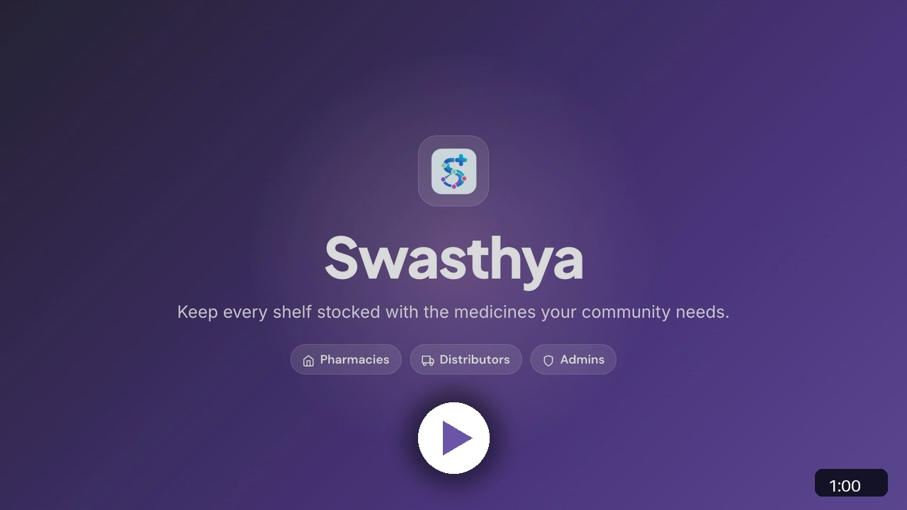
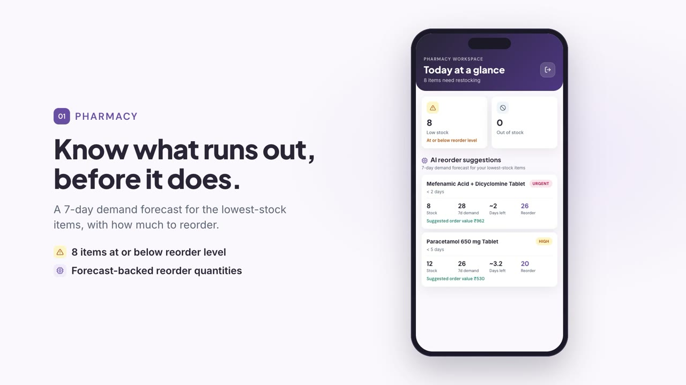
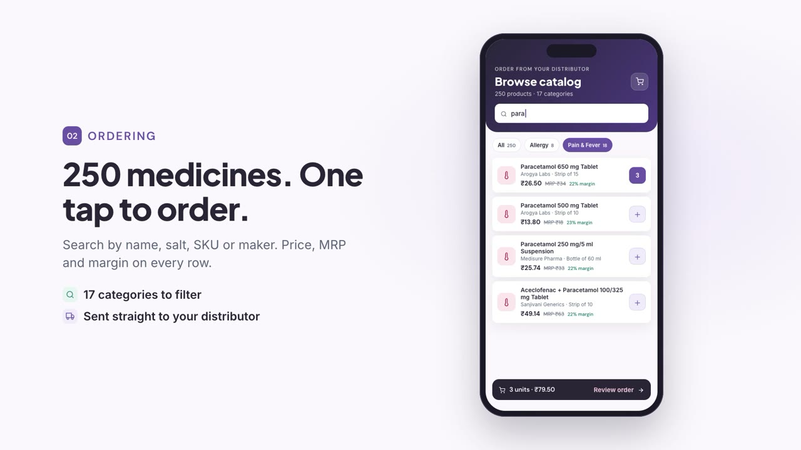
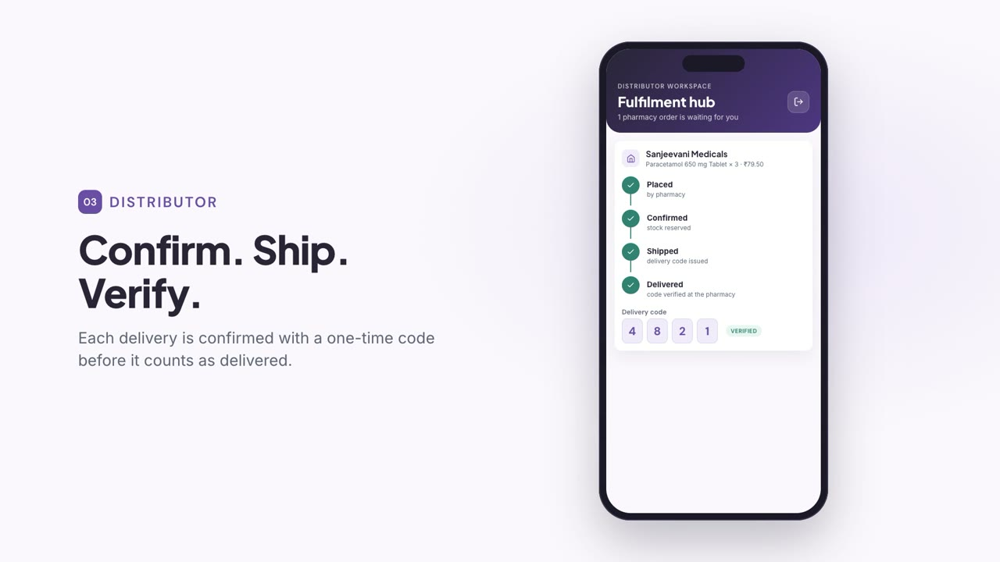
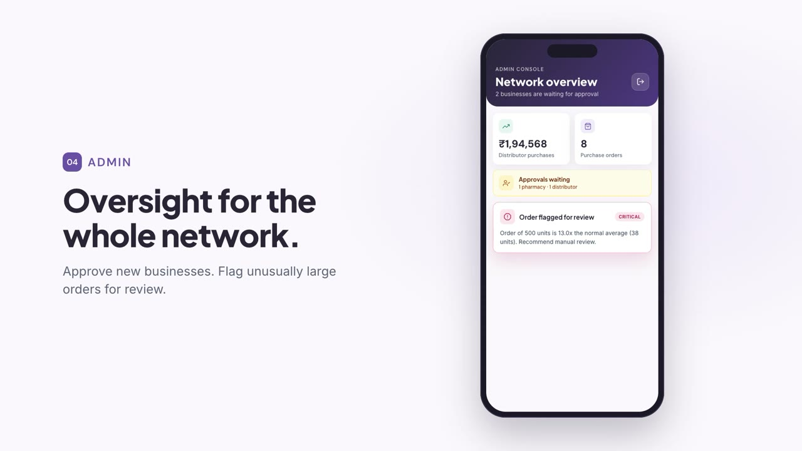
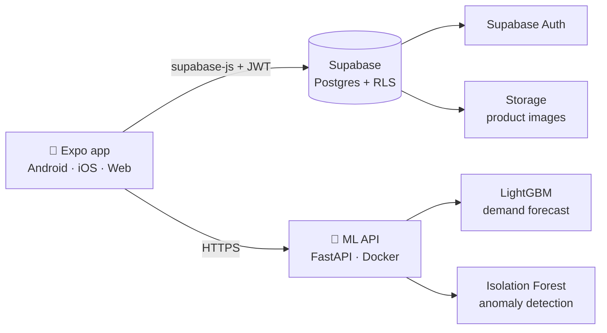
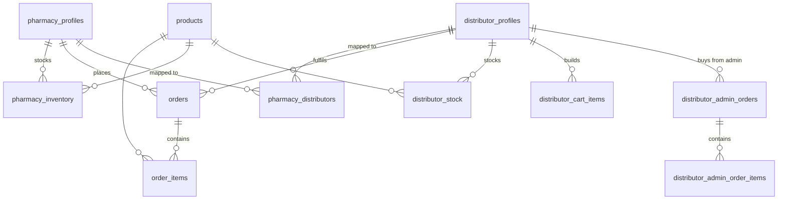

<div align="center">


# Swasthya

**Keep every shelf stocked with the medicines your community needs.**

A pharmacy supply network that connects pharmacies, distributors and admins so medicine stock is forecast, reordered and delivered before it runs out.


[**▶ Watch the demo**](https://youtu.be/3o5NiLXtHKs) · [Features](#features) · [Architecture](#architecture) · [Getting started](#getting-started) · [Docs](#documentation)

</div>

---

## Demo

<div align="center">

<a href="https://youtu.be/3o5NiLXtHKs" title="Watch the Swasthya demo on YouTube">
  
</a>

**[Watch the one-minute narrated demo on YouTube →](https://youtu.be/3o5NiLXtHKs)**

</div>

---

## The problem

A patient walks into a neighbourhood pharmacy for a medicine they need today, and the shelf is empty. It keeps happening for three reasons:

| | Problem | How Swasthya addresses it |
|---|---|---|
| 📉 | **Stockouts.** Reorders are guessed, so fast-moving medicines run out. | A 7-day demand forecast flags what will run out before the next delivery and suggests how much to reorder. |
| 📅 | **Expiry losses.** Near-expiry batches sit unnoticed until they are wasted. | Batch and expiry tracking on pharmacy and distributor stock. |
| ☎️ | **Manual reordering.** Orders to distributors still go out by phone call. | One-tap ordering from a 250-product catalog, routed straight to the pharmacy's mapped distributor. |

## Features

<table>
  <tr>
    <td width="50%" valign="top">
      
      <h3>💊 Pharmacy</h3>
      <ul>
        <li>"Today at a glance" dashboard with low-stock and out-of-stock counts</li>
        <li>AI reorder suggestions from a 7-day demand forecast, ranked by urgency</li>
        <li>Inventory with reorder levels, batches and expiry dates</li>
        <li>Order tracking with delivery-code verification</li>
      </ul>
    </td>
    <td width="50%" valign="top">
      
      <h3>🛒 Ordering</h3>
      <ul>
        <li>Catalog of 250 general medicines and essentials across 17 categories</li>
        <li>Search by name, salt, SKU or manufacturer; filter by category</li>
        <li>Price, MRP and margin on every row; live cart total</li>
        <li>Orders routed to the pharmacy's mapped distributor</li>
      </ul>
    </td>
  </tr>
  <tr>
    <td width="50%" valign="top">
      
      <h3>🚚 Distributor</h3>
      <ul>
        <li>Fulfilment hub with pending pharmacy orders</li>
        <li>Order lifecycle: placed → confirmed → shipped → delivered</li>
        <li>One-time delivery code verified at the pharmacy</li>
        <li>Stock management and purchase orders to admin</li>
      </ul>
    </td>
    <td width="50%" valign="top">
      
      <h3>🛡️ Admin</h3>
      <ul>
        <li>Network overview: purchases, orders, pharmacies, distributors, products</li>
        <li>Approval queue for new pharmacies and distributors</li>
        <li>Pharmacy ↔ distributor mapping and catalog management</li>
        <li>Isolation Forest anomaly checks that flag unusually large orders for review</li>
      </ul>
    </td>
  </tr>
</table>

The app also includes customer-facing screens (cycle tracker, health quiz, learning content and the rule-based FlowBot assistant). They share the same design system but sit outside the B2B pilot scope.

## Architecture



- **Client.** Expo Router screens grouped by role under `app/`, with a shared UI kit in `components/ui/kit.tsx`.
- **Data.** Supabase Postgres. Row-level security limits every table to its owner, mapped partners and admins. A business's profile id is its auth user id, so ownership checks are consistent across tables.
- **ML.** `swasthya-api/` serves the forecasting and anomaly models over HTTP. The same Docker image runs locally or on a Hugging Face Space (`Dockerfile.lambda` keeps the AWS Lambda build).

<details>
<summary><b>Data model</b></summary>



| Table | Purpose |
|---|---|
| `admins` | Users with admin rights, checked by `is_admin()` |
| `pharmacy_profiles`, `distributor_profiles` | Business accounts and approval status |
| `pharmacy_distributors` | Which distributors supply which pharmacies |
| `products` | Master catalog: price, distributor price, MRP, MOQ, HSN code |
| `pharmacy_inventory`, `distributor_stock` | Stock with batch and expiry |
| `orders`, `order_items` | Pharmacy → distributor orders with delivery code |
| `distributor_admin_orders`, `distributor_admin_order_items` | Distributor → admin purchase orders |

Full schema and policies: [`supabase/migrations/20261025000000_init_schema.sql`](supabase/migrations/20261025000000_init_schema.sql).

</details>

## Tech stack

| Layer | Technology |
|---|---|
| App | Expo SDK 58, React Native 0.88, React 19, Expo Router, TypeScript |
| UI | Custom design system (Plus Jakarta Sans, Inter, DM Sans), Reanimated, Feather icons |
| Backend | Supabase: Postgres, Auth, Storage, row-level security |
| ML | FastAPI, LightGBM (demand forecasting), scikit-learn Isolation Forest (anomaly detection) |
| Infrastructure | Docker, Hugging Face Spaces (or AWS Lambda) |

## Getting started

### Prerequisites

- Node.js 20+
- A Supabase project
- Docker Desktop (for the ML API)
- The [Expo Go](https://expo.dev/go) app, or an iOS/Android simulator

### 1. Install

```bash
git clone https://github.com/adriennie/swasth-app.git
cd swasth-app
npm install
```

### 2. Configure environment

Create `.env` for server-side keys and `.env.local` for values the app bundles. Both are local only; never commit secrets.

```env
# .env
EXPO_PUBLIC_SUPABASE_URL=https://<project-ref>.supabase.co
SUPABASE_PUBLISHABLE_KEY=sb_publishable_...
SUPABASE_SECRET_KEY=sb_secret_...          # used only by the seed scripts

# .env.local
EXPO_PUBLIC_SUPABASE_PUBLISHABLE_KEY=sb_publishable_...
EXPO_PUBLIC_ML_API_URL=http://<your-lan-ip>:7860
SUPABASE_DB_HOST=aws-0-<region>.pooler.supabase.com
SUPABASE_DB_PASSWORD=<database password>
```

### 3. Set up the database

Run [`supabase/migrations/20261025000000_init_schema.sql`](supabase/migrations/20261025000000_init_schema.sql) in the Supabase SQL editor, then load the demo data:

```bash
npm run seed:users     # demo accounts via the Auth Admin API
npm run seed:data      # 30 products, stock and 90 days of order history
npm run seed:catalog   # 220 more products (safe to re-run)
```

### 4. Start the ML API

```bash
npm run ml:docker
```

### 5. Run the app

```bash
npm start
```

Scan the QR code with Expo Go, or press `w` for the web version. Demo accounts for each role are listed in [`docs/supabase_setup.md`](docs/supabase_setup.md).

### Scripts

| Command | What it does |
|---|---|
| `npm start` | Start Expo (scan the QR code with Expo Go) |
| `npm run web` / `android` / `ios` | Open a specific platform |
| `npm run lint` | Lint the project |
| `npm run seed:users` | Create demo login accounts |
| `npm run seed:data` | Load demo data into an empty project |
| `npm run seed:catalog` | Load the extended product catalog |
| `npm run ml:docker` | Build and run the ML API container on port 7860 |
| `npm run ml:deploy` | Deploy the ML API to a Hugging Face Space |

## Project structure

```text
swasth-app/
├── app/                 Expo Router screens, grouped by role
│   ├── (auth)/          Welcome, sign-in and registration
│   ├── pharmacy/        Dashboard, catalog, cart, inventory, orders
│   ├── distributor/     Fulfilment hub, stock, catalogue, orders
│   ├── admin/           Network overview, approvals, mapping, products
│   └── (tabs)/          Customer screens: tracker, FlowBot, learn
├── components/ui/       Shared UI kit (hero header, stat tiles, badges)
├── constants/           Design tokens, fonts, navigation helpers
├── lib/                 Supabase client
├── services/            ML API client and ID mapping
├── supabase/            Schema migration, seed data, CLI config
├── swasthya-api/        FastAPI ML service, Dockerfiles, trained models
├── ML/                  Training notebooks
├── scripts/             Seed, catalog and deployment scripts
└── docs/                Design, setup and architecture documentation
```

## Documentation

| Topic | Document |
|---|---|
| Database setup and demo accounts | [`docs/supabase_setup.md`](docs/supabase_setup.md) |
| ML API (Docker and Hugging Face) | [`docs/ml_api.md`](docs/ml_api.md) |
| UI design system | [`docs/ui_design_system.md`](docs/ui_design_system.md) |
| AI feature roadmap | [`docs/ai_features.md`](docs/ai_features.md) |
| System design | [`docs/system_design.md`](docs/system_design.md) |
| Requirements | [`docs/system_requirements.md`](docs/system_requirements.md) |
| Implementation notes | [`docs/implementation.md`](docs/implementation.md) |
| Testing | [`docs/testing.md`](docs/testing.md) |
| Challenges | [`docs/challenges.md`](docs/challenges.md) |

## Roadmap

- [x] Role-based workflows for pharmacies, distributors and admins
- [x] Supabase schema with row-level security and demo data
- [x] Demand forecasting and anomaly detection API (Docker / Hugging Face ready)
- [ ] Business copilot over inventory and orders (Hugging Face models)
- [ ] Invoice and stock-document extraction with human review
- [ ] Simulated payment gateway with server-side order lifecycle
- [ ] Forecast evaluation with WAPE and an MLflow model registry

See [`docs/ai_features.md`](docs/ai_features.md) for the full AI roadmap.

## Known limitations

- Demo data is synthetic; forecasts and anomaly results on it do not reflect real-world accuracy.
- The forecasting model's reported MAPE is unreliable on zero-sales days; WAPE-based evaluation is planned.
- The app queries Supabase directly, so access control relies on row-level security rather than an API server.
- Customer screens store their session locally and are outside the B2B pilot.

## Author

**Adrika Pradhan** — Final-year B.Tech (AI & ML)

- Google Cloud GenAI Internship: production ML systems, prompt engineering
- Astronomical object detection research: IoU improved from 0.51 to 0.69 with ensemble methods

📧 [adrika2607@gmail.com](mailto:adrika2607@gmail.com) · 💻 [github.com/adriennie](https://github.com/adriennie)

## License

No license has been chosen yet, so all rights are reserved by default. Add a `LICENSE` file to allow reuse.

## Acknowledgments

Built with [Expo](https://expo.dev), [React Native](https://reactnative.dev) and [Supabase](https://supabase.com). Demo video produced with [Hyperframes](https://hyperframes.heygen.com), with music from [ende.app](https://ende.app/en) ("Happy Beats / Business Moves") and CC0 sound effects by [Kenney](https://kenney.nl).
